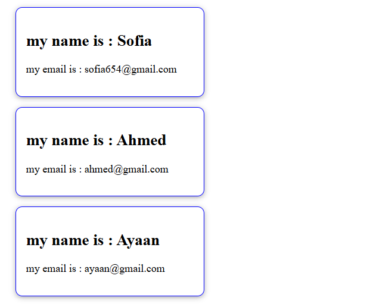
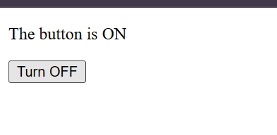
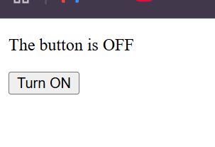

# React Exercises - Sofia Asad

Exercise lists

## Exercise 1: UserCard Component

### Result


### the code (UserCard.jsx)
```jsx
const UserCard=()=>{
    return(
        <div>
            <h2>Sofia Asad</h2>
            <p>my email: sphia654@gmail.com</p>
        </div>
    )
}

export default UserCard;
```

-------------------------------------------------------------------------

## Exercise 2: Blog Layout Component

### Result


### the code (Blog.jsx)
```jsx
import Header from './Header'
import Post from './Post'
import Footer from './Footer'

const Blog=()=>{
    return(
        <div>
            <Header/>
            <Post/>
            <Footer/>
        </div>
    )
}

export default Blog;
```
------------------------------------------------------------------------------------------------------------

## Exercise 3: Dynamic userCard

### Result


```jsx
import PropTypes from 'prop-types';

// Exercise 3
const UserCard2 = ({ name, email }) => {
    return(
        <div className="card">
            <h2>my name is : {name}</h2>
            <p>my email is : {email}</p>
        </div>
    )
}

UserCard2.propTypes = {
  name: PropTypes.string.isRequired,
  email: PropTypes.string.isRequired,
};


export default UserCard2
```

-----------------------------------------------------------------------------------------------------------

## Exercise 4: Toggle Button

### Result



```jsx
import { useState } from 'react';

const ToggleButton = () =>{
    const [isOn, setIsOn] = useState(false);
    const toggle = () => setIsOn(!isOn);

    return(
        <div>
            <p>The button is {isOn ? 'ON' : 'OFF'}</p>
            <button onClick={toggle}>{isOn ? 'Turn OFF' : 'Turn ON'}</button>
        </div>
    )

}
export default ToggleButton;
```
