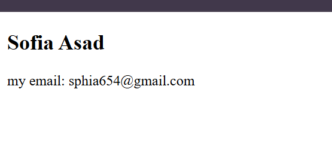
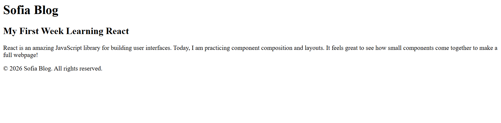

# React Exercises - Sofia Asad

Exercise lists

## Exercise 1: UserCard Component

### Result


### the code (UserCard.jsx)
```jsx
const UserCard=()=>{
    return(
        <div>
            <h2>Sofia Asad</h2>
            <p>my email: sphia654@gmail.com</p>
        </div>
    )
}

export default UserCard;
```

-------------------------------------------------------------------------

## Exercise 2: Blog Layout Component

### Result


### the code (Blog.jsx)
```jsx
import Header from './Header'
import Post from './Post'
import Footer from './Footer'

const Blog=()=>{
    return(
        <div>
            <Header/>
            <Post/>
            <Footer/>
        </div>
    )
}

export default Blog;
```